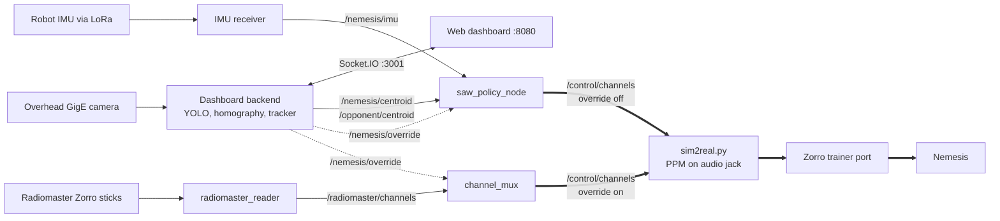

# Nemesis autonomy

Autonomous driving stack for Nemesis, the 250 lb combat robot. An overhead
camera finds both robots, the robot's IMU gives its heading, a neural-net
policy trained in `auton_training` picks tread speeds (and blade and arm
commands), and the PC sends them to the robot through the driver's
transmitter. The driver can take over at any time.

Full wiring diagram: [`docs/system_map.html`](docs/system_map.html) (open in a browser).



## What is where

| Folder | What it is |
| --- | --- |
| `nemesis_dashboard/` | Camera capture, YOLO detection, homography, tracking (`main.py`), camera setup window (`camera_setup.py`), React web UI (`src/`) |
| `nemesis_tracking/` | ROS package: `kalman_node` (smoothed pose and velocity) and its live plotter; debugging only, started with `plotter:=true` |
| `nemesis_policy_engine/` | ROS package: `saw_policy_node` flies an `auton_training` checkpoint (settings in `config/saw_policy.yaml`) |
| `nemesis_control/` | ROS package: `channel_mux` (manual/auto switch), `sim2real.py` (PPM output), Kalman tuning helper |
| `radiomaster_reader/` | ROS package: reads the transmitter sticks over USB |
| `telemetry/` | ESP32 firmware (robot transmitter, LoRa receiver) and the ROS IMU receiver |
| `nemesis_gazebo/` | ROS package: Gazebo worlds, sim bridges, robot models (`models/`: Nemesis and two generic opponents), all launch files (including the real-robot `nemesis.launch.py`) |
| `auton_training/` | Hammer-saw combat simulator, PPO trainer, web viewer, and `deploy.py`, the robot-side code the policy node runs |
| `scripts/` | Setup, build, launch and test scripts (below) |

## Setup (once)

Needs Ubuntu 24.04, ROS 2 Jazzy, `uv`, Node 18+, and
`sudo apt install python3-opencv python3-tk gstreamer1.0-plugins-bad gstreamer1.0-aravis aravis-tools libsdl2-dev libportaudio2`.
For the sims also `gz-harmonic ros-jazzy-ros-gz`.

```sh
scripts/setup_env.sh   # one Python environment for everything: ./.venv  (+ npm install)
scripts/build.sh       # colcon build of the ROS packages into ./install
scripts/test.sh        # checks that need no hardware
```

There is exactly one Python environment. It uses the system Python 3.12 with
system packages visible, because ROS and the GStreamer build of OpenCV only
exist there. `requirements-overrides.txt` keeps `opencv-python` and a new
`setuptools` out of it; both break things.

## Commands

Everything is run from the repository root.

**Once**

```sh
scripts/setup_env.sh            # build the Python environment (./.venv) and npm install
scripts/build.sh                # build the ROS packages (again after changing C++ or a setup.py)
scripts/test.sh                 # checks that need no hardware (environment, dashboard types, fake-sensor run of the ROS nodes)
```

**Robot**

```sh
scripts/all.sh                  # everything: ROS nodes, camera setup window, dashboard. Drive only
scripts/all.sh --manual         # same, but starts in driver control; press OVERRIDE to hand over
scripts/all.sh --no-ppm         # dry run: nothing goes to the transmitter
scripts/all.sh --no-policy      # dry run: no policy
scripts/all.sh --weapon         # also send the policy's blade and arm commands
scripts/all.sh --checkpoint ppo_models/my_run/SAW_upd100.pt    # another policy

scripts/camera.sh               # camera only: settings, preview, YOLO overlay, photos, video, calibration
scripts/camera.sh --check       # camera only, no window: finds it and prints FPS
scripts/dashboard.sh            # camera + vision + web dashboard, no autonomy
scripts/dashboard.sh --skip-setup    # same without the camera settings window
scripts/autonomy.sh             # ROS nodes only (policy, mux, radio, IMU, PPM)
scripts/autonomy.sh ppm:=false radio:=false plotter:=true      # any launch argument (plotter adds the Kalman view)
scripts/record.sh               # record every ROS topic to ~/match_data_logs

ros2 topic pub --once /nemesis/policy/reset std_msgs/msg/Empty # start a new fight (clock, swings, memory)
```

**Training sim (`auton_training`)**

```sh
scripts/viewer.sh               # web viewer at http://127.0.0.1:8765
                                #   Training tab: curves from logs/v8 and logs/v9
                                #   Replays tab: saved fights, and "Fight the policy":
                                #   you drive the opponent with WASD or the arrow keys
scripts/viewer.sh --fight ppo_models/my_run     # fight that run's newest checkpoint

cd auton_training && source ../.venv/bin/activate && export PYTHONNOUSERSITE=1

# train (about 4 GB of GPU memory at 32,768 fights; lower --n-envs on a smaller card)
mkdir -p logs/v9
python train_ppo.py --init ppo_models/saw_v8a_traves_hold/SAW_upd375.pt --init-std 0.25 \
    --name my_run/SAW --n-envs 32768 --epochs 2 --minibatch-envs 1024 --target-kl 0.02 --lr 1e-4 \
    --critic-warmup 10 --p-range 0.4 0.85 --gate-rule body --gate-persist 4 --priv-critic \
    --traves-share 1.0 --weapon-shares 0.1 0.1 0.8 --swings-3min 10 --foul 0.05 --save-every 25 \
    > logs/v9/train_my_run.log 2>&1 &
tail -f logs/v9/train_my_run.log                 # checkpoints land in ppo_models/my_run/
python train_ppo.py --resume ppo_models/my_run/SAW_latest.pt >> logs/v9/train_my_run.log 2>&1 &

python eval/poc180.py ppo_models/my_run/SAW_upd100.pt --lite       # score a checkpoint
python web/export_replays.py ppo_models/my_run/SAW_upd100.pt       # make replays for the viewer
python eval/deploy_check.py ppo_models/my_run/SAW_upd100.pt        # does it still fight when flown
                                                 # by the robot-side code (deploy.py)?
```

**Gazebo**

```sh
scripts/sim.sh                  # nn: Nemesis flown by the saw policy against a radio-driven opponent
scripts/sim.sh nn weapon:=true  # ... with the blade and arm joints driven too
scripts/sim.sh sim              # drive Nemesis by radio (also: playground, horiz_test, vert_test)
```

## Camera and arena setup

Hardware: PoE injector to power, short Ethernet from PC to "Data In", long
Ethernet from "Data Out" to the camera. Give it a minute to appear. Do not leave
the camera powered for more than 15 to 20 minutes.

1. `scripts/camera.sh` and click **Connect / Apply**. Defaults are 1920x1440 at
   70 FPS. Redo this every time the camera is replugged.
2. **Calibration** (only after the lens was moved or refocused): Calibration
   tab, tick Calibration mode, take 15 to 20 photos of the 8x5 checkerboard at
   different angles and distances, then Compute calibration. Result:
   `nemesis_dashboard/vision/camera_calibration.npz`.
3. **Homography** (every time the camera is moved): put the arena positions of
   at least 4 marked points (12 recommended) into `HOMOG_DEST` in
   `nemesis_dashboard/main.py`, in a known order. Start the dashboard, enlarge
   the live feed and click those points in the same order. To make it permanent,
   copy the printed pixel list into `DEFAULT_CLICKED_POINTS`.

   The policy's frame is **feet from a corner, with x and y along two walls and
   turns counter-clockwise positive** seen from above. Enter the arena points
   that way, or describe what you used in
   `nemesis_policy_engine/config/saw_policy.yaml` (`units`, `origin`, `y_down`,
   and the size of a test floor that is not the 48 ft BattleBox).

What the recorded Witch Doctor fight showed about the lens, the floor marks and
the robots' speeds is in [docs/camera_and_arena_notes.md](docs/camera_and_arena_notes.md),
including two things still to do before the next event.

## The policy on the robot

`saw_policy_node` runs a `SAW_*.pt` checkpoint from `auton_training`. The
observation, arm gate and tread mixer it needs are in `auton_training/deploy.py`,
which `eval/deploy_check.py` flies against the simulator.

- **Before a fight**, set the opponent's card and our robot's numbers in
  `nemesis_policy_engine/config/saw_policy.yaml`.
- **Heading.** The camera gives none. It starts as "facing the opponent" (or
  an angle you set) and then follows the IMU, nudged by the direction the robot
  actually travels. The IMU is required: without it the policy does not drive.
- **Weapon.** Blade and arm commands are always worked out but only sent with
  `--weapon`. Check which transmitter input PPM channels 3 (blade) and 4 (arm)
  drive, with the weapon disconnected, before using it.
- **The fight** (swing budget, the policy's memory, its "time left" input)
  starts the first time the policy has the robot. `/nemesis/policy/reset`
  starts another.

## Who drives, and what stops the robot

- The **OVERRIDE** button in the dashboard toggles `/nemesis/override`. Off: the
  policy writes `/control/channels`. On: `channel_mux` forwards the sticks instead.
- If our camera position or the IMU is older than 1 s, the policy stops publishing.
- If `/control/channels` is silent for 0.5 s, the PPM output centres the sticks
  and stops the blade.
- `scripts/all.sh` comes up autonomous unless you pass `--manual`.

## Not wired yet

- `HOMOG_DEST` is empty, so nothing downstream of vision runs until step 3 above is done.
- The robot numbers in `saw_policy.yaml` (body size, track width, latencies, arm
  timing) are the simulator's nominal values, not measurements.
- The transmitter's PPM channel mapping for blade and arm has not been checked.
- The telemetry receiver firmware source now matches the transmitter's packet
  (it was 4 bytes short and would drop every packet), but has not been compiled or flashed.
- Dashboard telemetry panels (ESC volts, current, temperature, IMU) have no data source yet.

## 6D pose (parked)

Not running. The hooks are still in place: the backend publishes
`/camera/image_raw` as soon as something subscribes, and `kalman_node` fuses yaw
from `/nemesis/pose` (PoseStamped) and `/opponent/rpy` (Vector3Stamped, z = yaw)
whenever they are published. The saw policy's observation has columns for the
opponent's heading (38 to 43, all zero today) and the arm gate already uses
them, so the tracker's output would go to `saw_policy_node` as well. To bring it
back, add the tracker as a package and start it from
`nemesis_gazebo/launch/nemesis.launch.py`.
