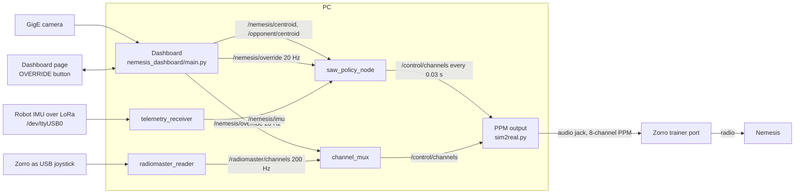
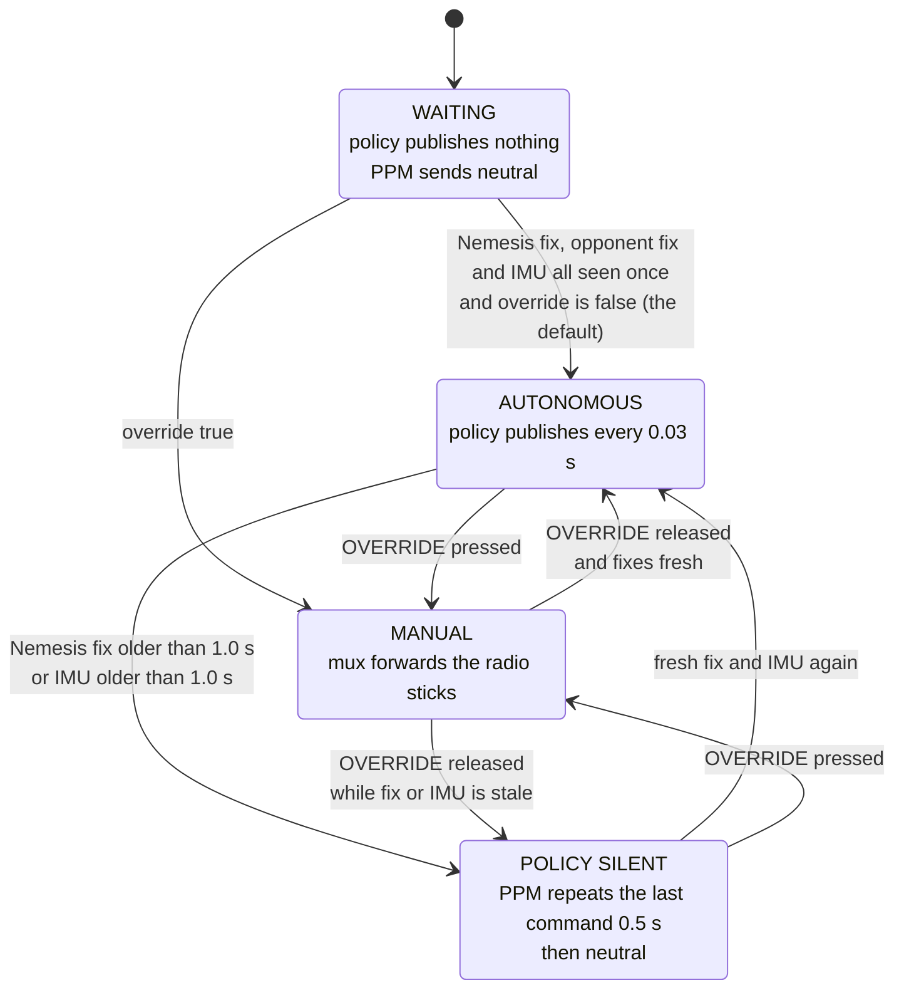

# Nemesis autonomy: state machine and known bugs

Written 2026-11-17 from the code on `main` (after the one-process dashboard was merged).
Everything here is from reading the code and running the hardware-free tests. Nothing was
measured on the robot, the transmitter or the camera.

## 1. Processes and topics

`scripts/all.sh` starts the ROS nodes (`nemesis.launch.py`) in the background and the
dashboard in the foreground. Start order inside the launch file: mux, radio reader, PPM
and IMU receiver at 0 s, policy at 5 s. The Kalman node only runs with `plotter:=true`
and nothing in the control path reads it.

`/control/channels` is `[left, right, blade, arm]`, each -1..1. Two nodes publish to it
(policy and mux); there is no arbiter. Each decides for itself from its own copy of
`/nemesis/override`, and the PPM node sends whichever message came last.

## 2. Who has the robot

- The only manual/autonomous switch is the dashboard's OVERRIDE button
  (`/nemesis/override`, True = driver). There is no radio switch.
- Start-up value: autonomous, unless `scripts/all.sh --manual` (`NEMESIS_START_MANUAL=1`).
- Policy and mux both start believing "autonomous" before they have heard any override
  message, and neither times the topic out: the last value is held forever.
- The policy never sends "stop". Not driving means it goes silent, and the PPM node turns
  silence into neutral after 0.5 s.
- "Fresh fix" means a real detection. Positions the dashboard's tracker extrapolates
  (`point.z = 1`) are ignored by the policy.

## 3. Each node

### Dashboard (`nemesis_dashboard/backend/`)

| Thread | Does |
| --- | --- |
| capture | camera frame -> newest-frame slot (and the recorder) |
| vision | waits for a new frame -> detector -> homography -> tracker -> publishes both centroids -> page |
| stream | JPEG to the page, one frame per "ready" from the page |
| web | page, WebSocket, OVERRIDE / swap / fight-video buttons, homography clicks |
| ROS (main) | publishes `/nemesis/override` at 20 Hz, independent of the camera |

States of the vision loop:

| State | Condition | Publishes |
| --- | --- | --- |
| No homography | `HOMOG_DEST` empty and no clicks (the state of `backend/config.py` today) | nothing to ROS; page only |
| Two-class model | model has a `nemesis` class (live camera and fight video) | Nemesis = most confident `nemesis`, opponent = most confident other |
| One-class model | `MediumBest.pt` and other old models | first sight: leftmost = Nemesis; after that nearest track |
| Coasting | a robot not detected this frame, track younger than 2.0 s | extrapolated position with `z = 1` |
| Track dropped | 2.0 s without a detection | nothing for that robot |
| Detector error | exception on a frame | frame skipped, logged every 5 s |

### Policy (`saw_policy.py`, tick every 0.03 s)

| State | Condition | Output |
| --- | --- | --- |
| WAITING | no Nemesis fix, no opponent fix or no IMU yet | nothing |
| MANUAL | override true | nothing; fight clock keeps running |
| STALE | Nemesis fix or IMU older than `stale_s` = 1.0 s | nothing |
| FIGHT START | first drivable tick | resets pilot and heading (faces the opponent), then drives |
| DRIVING | otherwise | `[left, right, blade or -1, arm or 0]` |
| BELL | `stop_at_bell` and clock at 0 (off by default) | nothing |

The opponent fix has no age limit. `/nemesis/policy/reset` starts a new fight.

### Mux, radio reader, IMU receiver

- **Mux**: override true -> republishes every `/radiomaster/channels` message. Otherwise silent. No timers.
- **Radio reader**: SDL joystick 0, axes 0-3 at 200 Hz. Exits at start if there is no joystick; nothing restarts it.
- **IMU receiver**: serial `/dev/ttyUSB0`. A serial error ends its read thread for good; the policy then goes STALE.

### PPM output (`sim2real.py`, loop every 20 ms)

| State | Condition | Channels |
| --- | --- | --- |
| LIVE | a `/control/channels` message in the last 0.5 s | 1-2 = treads; 3-4 = blade, arm only with `weapon:=true` |
| NEUTRAL | none yet, or last one older than 0.5 s | 1-2 = 1500; with weapon: 3 = 1000, 4 = 1500 |
| always | | 5-8 = 1500; without weapon 3-4 = 1500 |

Frames are generated into a queue that is kept about 50 frames (1.1 s) full.

### Time from an event to the transmitter (from the code)

| Event | Chain | Total |
| --- | --- | --- |
| Policy command or stick movement | PPM queue | about 1.1 s |
| OVERRIDE pressed | up to 0.05 s + PPM queue | about 1.2 s |
| Policy node dies | 0.5 s + PPM queue | about 1.6 s |
| Camera loses Nemesis | 1.0 s + 0.5 s + PPM queue | about 2.6 s |

## 4. Bugs

"Confirmed" = the code path was read end to end (and run where it could be without
hardware). "Suspected" = the code allows it but the trigger or the hardware side was not
verified.

### Could move the robot wrongly

1. **PPM queue adds about 1.1 s to everything** (confirmed in code, not measured).
   `nemesis_control/src/sim2real.py:40,102-111`. The generator tops the queue up to 50
   frames of 22.5 ms; a new stick value is appended behind them. The policy is configured
   for 0.07 s of command delay. If manual driving through the PC has never felt a second
   late, measure this first; from the code the queue cannot be shorter.
2. **The opponent position never expires** (confirmed). `saw_policy.py:167-171,230`.
   `_opp_t` is stored and never read. Once the opponent has been seen, the policy keeps
   attacking its last position for as long as Nemesis itself is seen.
3. **`y_down: false` against a clockwise camera frame** (confirmed for the fight-video
   homography). `saw_policy.yaml:20`, `docs/camera_and_arena_notes.md`. With a clockwise
   frame and `y_down: false` every turn is mirrored: the robot turns away from the
   opponent. The live `HOMOG_DEST` is empty, so the live handedness is whatever gets
   entered; `y_down` has to be set to match it.
4. **NaN becomes full reverse and stays** (propagation confirmed, no trigger found).
   `sim2real.py:55-58`: `float_to_us(nan)` is 1000. A NaN from the IMU or a centroid goes
   through the policy (heading and recurrent state stay NaN until a reset) and is published
   as a fresh command, so the PPM failsafe never trips.
5. **Blade channel sits at 1500 us when the weapon is off** (confirmed in code; the effect
   depends on the Zorro's trainer mapping). `sim2real.py:51,172-174`. The file's own
   convention is 1000 = stopped. With `weapon:=true` the first second after start is also
   1500 (queued before the main loop writes 1000).
6. **Autonomous is the default, and a dashboard restart hands the robot back to the
   policy** (confirmed). `saw_policy.py:133`, `channel_mux.cpp:16`, `backend/config.py`
   (`start_manual`). With `autonomy.sh` and `dashboard.sh` in separate terminals: press
   OVERRIDE, restart the dashboard, and it publishes "autonomous" again.
7. **One-class tracker can swap the robots** (confirmed in code). `backend/tracker.py:13`:
   `ASSOC_MAX_DIST = 100` in a 48 ft arena never rejects a match, so when one robot is
   missed its track takes the other robot's detection, published as a real fix. Only with a
   one-class model; the live camera now loads the two-class one.
8. **Frozen IMU data counts as fresh** (code path confirmed, trigger suspected).
   `transmitter.ino` keeps sending the last packet if the sensor stops; `saw_policy.py:188`
   judges freshness by arrival time.

### Stops the system working

9. **The live camera publishes no positions** (confirmed). `backend/config.py:60-62`:
   `HOMOG_DEST` and `DEFAULT_CLICKED_POINTS` are empty, so there is no homography and the
   policy stays in WAITING. Only fight-video mode has one.
10. Fixed 2026-11-17: the live camera now loads the two-class model
    (`YOLO_models/all_fixes_1280.pt` at 1280 px), so bug 7 only applies if a one-class
    model is put back.
11. **No node is restarted and nothing notices one dying** (confirmed). `nemesis.launch.py`
    has no respawn; `all.sh` does not watch the launch. Every single death ends in neutral
    sticks, except the PPM node itself, where the signal stops and the Zorro decides.

### Smaller

12. The last drive command is repeated for 0.5 s after the policy goes silent
    (`control_listener.py:10`), on top of bug 1.
13. Two-class mode takes "the most confident non-Nemesis detection" as the opponent, with
    no check against where the opponent was; a parked robot can win (suspected).
14. A numeric `initial_heading` in the yaml must be quoted or the policy node will not
    start (suspected, not run).
15. Radio reader does not notice the transmitter being unplugged and keeps publishing
    (suspected; depends on SDL).
16. Kalman node (plotter only): never times out, uses extrapolated points as fixes, and
    its constants are in metres against feet.
17. Dashboard can print one `publisher's context is invalid` error when stopped with
    Ctrl-C (seen once in four runs; shutdown only).

### Not checked

Zorro trainer mapping and failsafe, the receiver firmware, `kalman_plotter.py`,
`nemesis_tuning.py`, the gate logic inside `auton_training/`, the Gazebo launch files, and
the camera setup window with a real camera.
